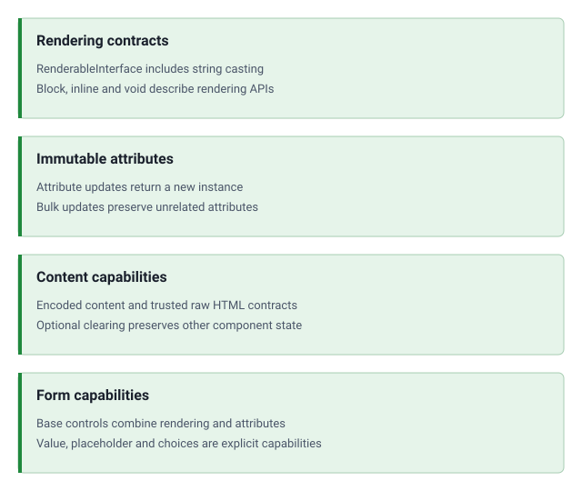

<!-- markdownlint-disable MD041 -->
<p align="center">
    <a href="https://github.com/ui-awesome/html-contracts" target="_blank">
        
    </a>
    <h1 align="center">HTML Contracts for PHP</h1>
    <br>
</p>
<!-- markdownlint-enable MD041 -->

<p align="center">
    <a href="https://github.com/ui-awesome/html-contracts/actions/workflows/static.yml" target="_blank">
        
    </a>
</p>

<p align="center">
    <strong>Contracts (interfaces) for the UI Awesome HTML ecosystem for PHP</strong><br>
    <em>Provides shared interfaces for rendering, attribute management, and form control typing across HTML packages.</em>
</p>

## Features

<picture>
    <source media="(min-width: 768px)" srcset="./docs/svgs/features.svg">
    
</picture>

## Quick start

### Installation

```bash
composer require ui-awesome/html-contracts:^0.2
```

### Basic usage

#### RenderableInterface

Core contract for any object that can be rendered as an HTML string. Extends `Stringable`.

```php
<?php

declare(strict_types=1);

use UIAwesome\Html\Contracts\RenderableInterface;

final class MyTag implements RenderableInterface
{
    public function __toString(): string
    {
        return $this->render();
    }

    public function render(): string
    {
        return '<div>Hello</div>';
    }
}
```

#### AttributesInterface

Contract for objects that manage HTML attributes with an immutable API.

Methods: `addAttribute()`, `attributes()`, `class()`, `getAttribute()`, `getAttributes()`, and `removeAttribute()`.

#### ContentInterface

Contract for immutable encoded element content. `content(string|Stringable|UnitEnum ...$values)` normalizes enum
values before HTML encoding; `getContent()` returns accumulated content, and `html(string|Stringable|UnitEnum ...$values)`
normalizes enum values and appends trusted raw HTML without encoding or sanitizing. Backed enums use their value (including integer zero); pure enums use their name.

Existing callers remain compatible. Implementations and overrides retaining the old narrower signature must be
updated; see [signature compatibility](docs/examples.md#signature-compatibility) before upgrading implementations.

#### ClearableContentInterface

Optional capability extending `ContentInterface`. `clearContent()` returns a new instance with empty content,
preserving other component state. Existing `ContentInterface` implementations need no changes.
Call `clearContent()->content($value)` to replace accumulated content with encoded text.

#### FormControlInterface

Composed interface extending both `RenderableInterface` and `AttributesInterface`. Use this to type form control
elements (inputs, selects, textareas, etc.) that need both rendering and attribute management.

```php
<?php

declare(strict_types=1);

use UIAwesome\Html\Contracts\Form\FormControlInterface;

function renderField(FormControlInterface $control): string
{
    return $control->class('form-control')->render();
}
```

## Documentation

Practical guides for implementing framework-independent HTML interfaces and verifying their contracts.

- 📚 [Installation guide](docs/installation.md)
- 💡 [Implementation examples](docs/examples.md)
- 🧪 [Testing guide](docs/testing.md)

The documentation site imports the [guides](https://yii2-framework.github.io/docs/extensions/html-contracts/) and generates
an [API reference](https://yii2-framework.github.io/docs/extensions/html-contracts/reference/) from the PHPDoc in `src/`.

## AI assistance

AI agents: read the [documentation index](https://yii2-framework.github.io/docs/llms.txt) and fetch the Markdown version
of a page by appending `index.md` to its URL. The
[AI agents guide](https://yii2-framework.github.io/docs/project/ai-agents/) covers skill installation, client setup and
verification.

- 🤖 [`ui-awesome-html-contracts` skill](docs/agents.md): immutable implementations, encoded versus raw content,
  and explicit form-control capabilities.

Match the installed contract and implementing package revisions. If hosted documentation does not match or is
unavailable, use the [repository guides](#documentation), the [skill source](skills/ui-awesome-html-contracts/SKILL.md),
the source PHPDoc and the [changelog](CHANGELOG.md). This interfaces-only package does not supply a renderer or require Yii.

## Package information

[](https://www.php.net/releases/8.3/en.php)
[](https://packagist.org/packages/ui-awesome/html-contracts)
[](https://packagist.org/packages/ui-awesome/html-contracts)

## Project status

[](https://github.com/ui-awesome/html-contracts/actions/workflows/static.yml)
[](https://github.com/ui-awesome/html-contracts/actions/workflows/quality.yml)
[](https://github.styleci.io/repos/ui-awesome/html-contracts?branch=main)

## Security

[](https://scorecard.dev/viewer/?uri=github.com/ui-awesome/html-contracts)
[](https://github.com/ui-awesome/html-contracts/actions/workflows/security.yml)

## Built with AI

[](https://openai.com/codex)

## Our social networks

[](https://x.com/Terabytesoftw)
[](https://www.facebook.com/wilmer.arambula.9)

## License

[](LICENSE)
